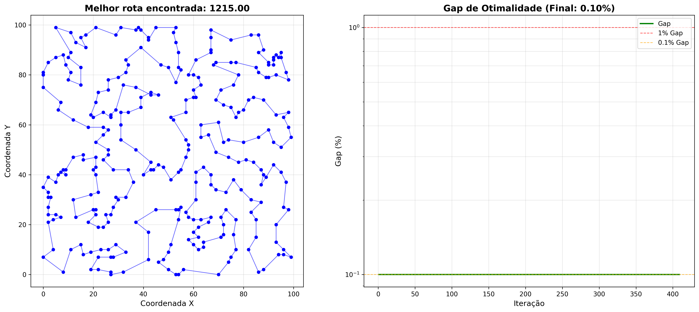

# Caixeiro Viajante

## Descrição
Solução para o Problema do Caixeiro Viajante (TSP - Traveling Salesman Problem), um dos problemas clássicos de otimização computacional.

## Objetivo
Encontrar a rota mais curta que visita todas as cidades exatamente uma vez e retorna ao ponto de partida.

## Algoritmo
1. Tour inicial por curva de Hilbert (O(n log n)).
2. **Lin-Kernighan** (cadeia de flips 2-opt, profundidade até 30, largura 5/3/2/1…) com fila de cidades alteradas e **6 candidatos por cidade escolhidos por alpha-nearness** (subgradiente de Held-Karp + MST sobre o grafo dos 16 vizinhos mais próximos, como no LKH).
3. **ILS**: perturbação double-bridge local, nova busca só nas pontas alteradas, desfeita por um log de reversões (custo proporcional ao que mudou, não a n). Aceita pioras com probabilidade `exp(-delta/T)` (T = 0,1 × aresta média, só até 20 mil nós) e guarda o melhor tour.
4. **Paralelo**: um processo por núcleo; a cada 1/20 do tempo todos recomeçam do melhor tour encontrado, com seeds diferentes.

Sem matriz de distâncias: o núcleo calcula EUC_2D das coordenadas (vizinhos por grade uniforme), então a memória é O(n). A matriz só é usada quando vem no arquivo (formato próprio de `gerador_tsp.py`).

O núcleo está em `tsp_core.c`, compilado com `cc` na primeira execução e chamado por `ctypes`. Sem compilador, `tsp.py` cai numa versão Python (2-opt + Or-opt + ILS) que usa matriz e só serve para instâncias pequenas.

## Requisitos
- Python 3.8+
- Bibliotecas: numpy, matplotlib
- `cc`/`gcc` (opcional, mas recomendado)

## Instalação
```bash
pip install -r requirements.txt
```

## Uso
```bash
python tsp.py instancia.txt [tempo_ils_segundos]
python test_tsp.py
python benchmark.py [tempo_s] [n_seeds] [instancias...]   # várias seeds em paralelo
```
Aceita o formato próprio (`gerador_tsp.py`) e arquivos TSPLIB `EUC_2D` (`tsplib/`). Gera `<instancia>_solucao.txt` e `<instancia>_grafico.png`.

## Exemplo de Saída


## Estrutura
```
├── tsp.py            leitura, solver Python (fallback), saída e gráfico
├── tsp_core.c        núcleo Lin-Kernighan + ILS
├── benchmark.py      várias seeds em paralelo
├── test_tsp.py       validade do tour + qualidade no eil51
├── gerador_tsp.py    gera instâncias aleatórias
├── tsplib/           instâncias TSPLIB com ótimo conhecido
├── *_tsp.txt         instâncias aleatórias
└── requirements.txt
```

## Resultados
Todos os núcleos (8 processos), 4 seeds por instância. Gap contra o ótimo TSPLIB; nas aleatórias (sem ótimo conhecido), contra o melhor valor visto.

| Instância | Nós | Tempo | Melhor | Média | Pior | No ótimo |
|-----------|----:|------:|-------:|------:|-----:|---------:|
| eil51, berlin52, kroA100, eil101, ch150, kroA200, a280, pcb442 | 51–442 | 5 s | 0,00% | 0,00% | 0,00% | 4/4 cada |
| rat783 | 783 | 30 s | 0,00% | 0,00% | 0,00% | 4/4 |
| pr1002 | 1002 | 30 s | 0,00% | 0,00% | 0,00% | 4/4 |
| pr2392 | 2392 | 30 s | 0,14% | 0,19% | 0,27% | 0/4 |
| 1000_tsp (aleatória) | 1000 | 30 s | 2279 | 2279,0 | 2279 | – |
| 2000_tsp (aleatória) | 2000 | 30 s | 3195 | 3196,2 | 3197 | – |

Instâncias grandes (uma execução, 30 s de ILS, 8 processos; o tempo de parede inclui leitura, preparo e a busca local inicial). Não há ótimo conhecido; o "vs. estimativa" usa a fórmula assintótica 0,7124·√(n·A) para pontos uniformes, que ignora o efeito de borda:

| Nós | Parede | Memória | Comprimento | vs. estimativa |
|----:|-------:|--------:|------------:|---------------:|
| 5 000 | 33 s | 175 MB | 511 584 | +1,6% |
| 10 000 | 32 s | 180 MB | 720 323 | +1,1% |
| 50 000 | 40 s | 213 MB | 16 162 557 | +1,5% |
| 100 000 | 65 s | 252 MB | 23 006 724 | +2,1% |
| 200 000 | 135 s | 327 MB | 32 619 403 | +2,4% |

Acima de ~20 mil nós o ILS faz poucas iterações e a qualidade vem quase toda do Lin-Kernighan; o tour em array tem inversão O(n) no pior caso, o que vai pesar além de algumas centenas de milhares de nós.

Evolução (pr2392, média): Python 2-opt + Or-opt 1,15%; núcleo C com 10 vizinhos 0,12%; alpha-nearness com matriz densa chegou a medir 0,01% em uma rodada, mas não consegui reproduzir após a reescrita sem matriz (atual: 0,19%). Versão original do projeto (clusters + Dijkstra + 3-opt + tabu): 200_tsp = 1052 em 11 s e 500_tsp = 1716 em 94 s.

Testado e descartado: Or-opt dentro do LK (pr1002 0,21% vs 0,15% e pr2392 0,31% vs 0,28% sem ele, 16 seeds).

O gráfico de gap é relativo à melhor solução da própria execução, não ao ótimo.

## Licença

Copyright © 2025 Beatriz Nahas, João Plinta, Rafael Alves  
Todos os direitos reservados.

Este código é propriedade privada. Nenhuma parte deste software pode ser reproduzida, distribuída ou utilizada sem permissão prévia por escrito dos autores.

Para mais detalhes, consulte o arquivo [LICENSE](LICENSE).

## Contato

Para dúvidas ou sugestões, entre em contato com os autores.